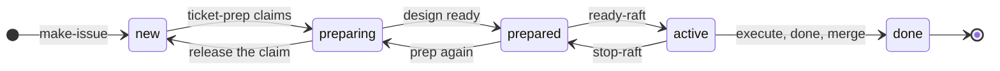

# Skills and the issue flow

The rules are the skills in `.claude/skills/`. Read the one that matches the task before acting. `AGENTS.md` is the index. This page is the map.

## Skills

| Skill | Read it when |
|---|---|
| `make-issue` | Someone describes work, a bug, or a chore. Capture a backlog issue. |
| `ticket-prep` | Turn backlog issues into one raft: design, `check.sh`, acceptance specs, design review. |
| `ready-raft` | Claim a prepared raft, move it to `active/`, write its prompt. |
| `launch-raft` | Start a readied raft: read `prompt.md`, enter its worktree, follow the prompt. |
| `execute-raft` | Deliver that raft: one branch, one PR, through merge. |
| `stop-raft` | Undo ready, or give back a started raft's claim. The branch and PR stay. |
| `review` | Adversarial review. Design mode during prep. Code mode before a PR leaves draft. |
| `tracker` | IDs, directories, worktrees, `tracker.sh`, spend. Read before creating, moving, committing, or finishing tracked work. |
| `architecture` | Before designing or writing anything in `src/`. |
| `testing` | Before writing specs or `check.sh`, or running the gate. |
| `metrics` | Cost per issue and the rework rate. Computed, not committed. |

## Flow

One type per raft: feature (`f`), defect (`d`), or chore (`c`). CI and test fixes are chores. A lone issue still gets a raft (`--single`).

1. **make-issue**, in `capture-<slug>`. The issue lands on `main` with `design: draft` and status `new`. No PR.
2. **ticket-prep**, in `prep-<slug>`. `new raft` claims the issues (`preparing`). Fill the designs, the checks, and the specs. A clean reviewer writes `design-review-NNN.md`. When that round is finished, `design: ready` and `status prepared`, then the prep PR merges.
3. **ready-raft**, from the main checkout. The raft and its issues move to `active/`. The prompt is written and gitignored.
4. **launch-raft**, then **execute-raft**, in `.worktree/R0010`. `start` opens a draft PR. Experiments, then tests, then the change. A clean reviewer writes `review-NNN.md`. `done` promotes the acceptance specs, moves the items to `done/`, and marks the PR ready. Merge it when the gate and Beta CI are green.
5. **stop-raft**, from the main checkout, sends an `active` raft back to `prepared` and deletes the prompt. It does not close the PR.

`design:` is separate from status, and only ticket-prep changes it: `draft` → `reviewed` → `ready`. The board's Ready / Not ready / Done groups are a view, not a status. A backlog raft is Ready when its design is ready and its effective status is `prepared`. An `active` raft is Ready. Copy the command on the row.

## State machine

Status is `new`, `preparing`, `prepared`, `active`, or `done`. A stamp looks like `prepared-otter-falcon-amber`. `done` is the move into `done/`, not a hand-set stamp. `preparing` can return to `new` (the claim released) or to another round of prep from `prepared`.

While `active`, execute-raft runs in order: claim (`start`), experiments, implement, whole-raft check, code review, `done`, merge. `stop-raft` can fire from `active` until `done` has moved the items.

## Where the work lives

The main checkout stays on `main`. Edits happen under `.worktree/`.

| Work | Worktree |
|---|---|
| Capture | `capture-<slug>` |
| Prep | `prep-<slug>` |
| Execution | `R0010`, branch `R0010-<slug>`, one PR |
| A skill, doc, or config edit | `<area>-<slug>` |

A skill or doc change still has an issue, and normally a raft, and then follows the same flow.
