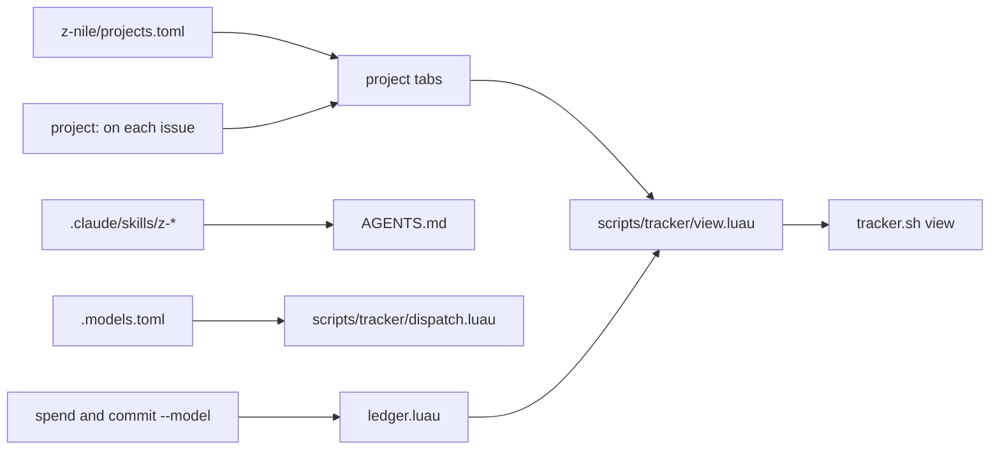

# R0042: z-nile

## Theme
These six chores are the tooling project. c0111, skill lessons, was R0040 and is folded in here. A river carries rafts to the sea: z-nile is that river, a raft is a batch of issues, and landed work is the sea. All five are chores. None of them change the game.

No product decision in `tracker/game-design.md` applies. This raft does not quote one.

## Whole-raft design
`src/` and `tracker/architecture.md` stay untouched. There is no new Logic dependency. Every issue and raft stays under `tracker/`. A frontmatter key `project:` says which tab it belongs to. The default, and the value when the key is absent, is `pickman`. New Luau lives in `scripts/tracker/`, which the gate already formats, lints, and typechecks. `z-nile/` holds `projects.toml`, the README, and the board template. New skills live under `.claude/skills/` beside the old ones, so the harness can invoke them. The old skill files stay, because promoted specs and `renderPrompt` read them. Seven of the new files match their source apart from the `name:` line. `z-design`, `z-raft`, `z-run`, and `zz-rules` are the ones this raft changes on purpose.



- c0111 adds lesson files under the existing skills, a `## Lessons` section at the end of each old `SKILL.md`, and the lessons index in the execution prompt. Its review files and `harvest.md` stay in `tracker/rafts/R0040/`, because the lesson sources name that raft. R0040's `issues:` list is empty.
- c0114 adds the tab list and the `project:` key. It does not add a second issue directory. Publish, claims, ids, ready, and stop stay on `tracker/`.
- c0115 adds the `z-` and `zz-` skills under `.claude/skills/` and the README. The old files stay. `SKILLS_INLINED` is not changed.
- c0116 teaches `new raft` to accept prepared members, and adds `recombine` as a worktree edit. It edits `z-design`, `z-raft`, and `zz-rules`, not `ticket-prep` or `tracker`.
- c0117 adds the model stack, `dispatch --dry-run`, and an optional model cell. A file with no model row stays nine columns.
- c0118 adds the pure view and `tracker.sh view`. The column for a prepared issue that already has a raft is `rafted`. `tracker.sh board` stays.

`z-nile/projects.toml`:

```toml
id = ["pickman", "z-nile"]
```

## Order & dependencies
c0111 first: it writes the Lessons section onto the old skill files. c0115 copies those files, so it depends on c0111. c0114 is next among the z-nile issues: the other z-nile issues read `project:` or `projects.toml`. c0117 after c0114. c0116 after c0115. c0118 last: it reads the project list and the model cell. No member depends on an issue outside the raft.

## Experiments phase
- E1. Does a closer `.models.toml` replace one key and keep the rest? Prototype `tracker/issues/c0117/experiments/rank.luau`. Result during prep: recorded on c0117. Fallback: the closer file replaces the whole skill table.
- E2. Does `ledger.parse` reject a 10-cell row today? Read `scripts/tracker/ledger.luau`: `#c ~= 7 and #c ~= 9` returns an error. Result: a model cell needs the parser taught. Fallback: there is no second file; the cell is the design.
- E3. Do the prep specs lint? `selene` on `tracker/issues/c0114` through `c0118` and `tracker/rafts/R0042` printed 0 errors after the unused `idOf` was removed. `stylua --check` on the same paths exited 0.

## Exit criteria
`scripts/tracker.sh done R0042` succeeds. RC0 is the full gate, each member's `check.sh`, and `promote-check`. RC1 is `git diff --quiet origin/main...HEAD -- src tracker/architecture.md`. RC2 creates a z-nile issue in a fixture, runs `tracker.sh view --out <path> -O`, decodes the embedded JSON, and finds that id only on the z-nile view, which also has a pickman view. The spec is `tracker/issues/c0118/acceptance/tab.spec.luau`, so `promote-check` type-checks it with the member specs. `done` promotes only member `acceptance/` folders.

## Risks & rollback
Promoted specs pin `.claude/skills/` and the nine-column spend header. This raft adds files. A spend file that has at least one model row renders ten columns. Revert the `z-nile/` tree, `.models.toml`, and the parser's 10-cell arm to restore main. No tracker document moves between roots in this raft: tooling issues are new, and pickman's issues stay in `tracker/`.

The board page is new. `tracker.sh board` stays until that page can replace it.

## Addressed during execution
