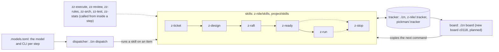
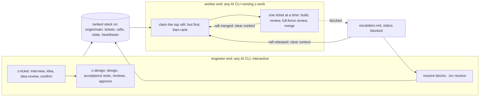
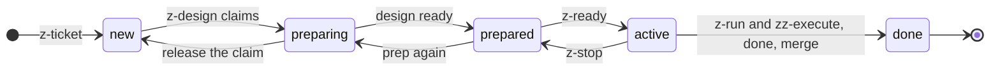

# z-nile

z-nile is the tooling that tracks, designs, gates and delivers the work of every project in this repository. A game is a project: pickman is one, in `pickman/`. The arcade adds five more (c0183): the shared library `arcade`, the start place `portal`, and the games `snake`, `invaders` and `asteroids`, each in its own folder. z-nile belongs to no game.

## Intent
z-nile exists so that people spend their time on ideas and designs, and agents carry everything after that to merge. This section is the intent, set by the user (2026-11-07, c0264); what of it is built is labelled sub-section by sub-section in How it should work.
- **People work at the idea and the design.** A person brings an idea. z-ticket challenges it, keeps the person's words and every question and answer, writes the idea out clean, has it checked against what they said and confirms it with them. z-design turns the confirmed idea into a design with acceptance tests as code, reviewed back and forth, and a person approves it. Apart from resolving a block, those are the only two stages that ask a person for anything.
- **Workers carry it to merge.** A worker is any AI CLI running `z-work`. It takes a raft and stays with it until it merges, one ticket at a time, then clears its context and takes the next raft.
- **The result stays true to the ask.** Before a ticket merges, a final full-force review compares the original ask, the design and the implementation, without the compromises made on the way, and sends the work back when it went off course.
- **It stays cheap.** Sharp, expensive models do every final review; cheaper, faster ones do the work on the way there; the cheapest do the waiting. An expensive model never orchestrates or waits.
- **Every decision has a name.** A ticket says whose idea it was, who approved its design, who unblocked it and which worker delivered it.

## How it should work
Status labels, on every sub-section below and every roadmap row (*captured* is this section's word for an issue that exists as a draft): **exists** (built and on `main`), **designed** (its issue's Design is ready, not built), **captured** (an issue exists as a draft with no design yet). Nothing below is described as built unless it is labelled *exists*. A feature's PR changes its own roadmap row and every label that names it. Older notes in this file written "(cNNNN, planned)" predate these labels and mean not built.

### Two ends, one stack
- **The engineer end.** You sit in any AI CLI (`claude` and `agent` today; another CLI once its skill support is checked, c0115) in the main checkout and run the front of the pipeline: `z-ticket` to capture, `z-design` to sharpen an idea into a prepared issue, the design reviews. Everything you produce is tracker state landed on `main`: by pull request, or, for a capture or a claim, pushed straight to it (`./zn land`, `./zn status`). *exists*
- **The worker end.** Any AI CLI runs the back of the pipeline: you start one by hand and run `z-work` in it, or a wrapper launches one headless (`./zn work`), on the same host or another. *captured* (c0253), on top of c0117's dispatcher (`./zn dispatch`, its chain, `.models.toml`, quota fallback, spend), which *exists* (c0117).
- **The only shared thing is `origin/main` and GitHub.** No daemon, no queue server. A worker on another machine needs a clone, its CLIs and a bot credential; the engineer sees it work on the board. *captured* (c0254)

### The idea stage
z-ticket challenges an idea before anything is designed. *captured* (c0260), on top of the confirmation of intent, *designed* (c0247).
- The ticket keeps the person's ask verbatim, every message of it, dated, and every question z-ticket asked with its answer, in order.
- From all of that z-ticket writes a clean, fully formed idea, and a clean adversarial reviewer on a sharp model checks that it says what the person said: nothing dropped, added or bent.
- The person confirms the idea as it then stands. Only a confirmed idea goes to z-design, which works as it does today: a design, acceptance tests as code, reviews back and forth.

### The worker
A worker is an AI CLI running `z-work`: `kimi`, `agy`, `claude`, `grok`, `agent` or `deepseek`. *captured* (c0253); the CLIs beyond `claude`, `grok` and `agent`: *captured* (c0175).
- It claims the first raft in the order and stays with it all the way to merge, delivering it as a stacked PR set, one ticket at a time.
- It keeps one context for the whole raft, so what it learned on one ticket carries to the next.
- A worker clears its context and picks up the next raft whenever a raft ends: when the raft is merged, or when it is blocked and the worker lets it go. No context carries from one raft to the next.
- It lets go of a raft only when the raft is blocked.
- The worker itself runs on a cheap model: it never orchestrates on an expensive one, and its waiting (for a gate, CI or a review it handed to a sharp model) runs on the wait tier.
- A CLI that cannot read skills gets the same instructions from `./zn work`.

### Order
Tickets have no order today. They should: every issue and raft gets a `rank:` (integer, lower first; not the `rank` of `.models.toml`, where a higher one wins). *captured* (c0249)
- An unset `rank:` is the lowest rank, and equal or unset ranks fall back to the ticket number, so the order is always stable.
- Lost work comes first: anything in progress whose heartbeat is stale comes before anything not yet started, whatever its rank, even when a person started it without changing its rank. *captured* (c0265)
- The next item is the first in that order whose `depends_on` are all done, which is not blocked, and whose status is claimable. `depends_on` is a hard constraint; `rank` only orders what is free, so the order works around a blocked item without changing any rank.
- z-ticket and z-design append by default. You move things with `./zn rank <id> top|after <id>|unset`. z-raft asks for a raft's rank when it makes the raft, and unset is a valid answer. A raft takes the best rank of its members. The board shows the stack in order.
- The z-nile app in Omarchy shows the same order, marks lost items, and reorders by drag and drop through `./zn rank`. *captured* (c0257)

### Claiming across hosts
A worker claims an item by landing the status change on `origin/main`, as `status <id> preparing` and z-ready already do. The push is the lock: a lost race means taking the next item. Each step runs in its own worktree under `.worktree/` on the worker's host. The worker's identity (host, CLI, model) goes on its spend rows. *captured* (c0254) (the claim itself *exists*)
- A worker that holds an item updates a heartbeat on it every 5 minutes, pushed to `main`. An item in progress whose heartbeat is stale is lost, and the next worker resumes it. *captured* (c0265)

### Autonomous delivery
Unless something blocks, once a person has approved its design, an item is rafted, executed, code-reviewed, full-force reviewed, tested and merged with no human in the loop. Rigor does not drop: tests first, sequestered `check.sh`, the full gate once at the merge, and a merge only when the PR is green and regression-free. This replaces c0117's "stops at a merge" gate with the dispatcher merging after its own checks. *captured* (c0252)

### Model tiers
Each CLI has three models: cheap, sharp and wait. *captured* (c0261)
- Sharp, the expensive one, does every final review: the idea review, the final design review round, the final code review round and the full-force review.
- Cheap, faster, does everything on the way there: authoring, the middle review rounds, the streams, the fixes. For `grok` and `agent` cheap is 4.6 at high and sharp is 4.7 at xhigh; for `claude` cheap is Sonnet and sharp is Opus.
- Wait, the cheapest (Haiku, composer or similar), does the waiting and the polling. An expensive model never orchestrates and never waits.
- Spend records the tier with the model.

### Reviews by different models
- A reviewer should run on a different model family than the author, and successive rounds rotate (author Sonnet, round one Opus through `claude` or `agent`, round two `grok-4.7-xhigh` through `grok`). `.models.toml` names a review pool; the dispatcher takes the first member whose family differs from the author's and the previous round's reviewer. *captured* (c0251); what c0117 built (*exists* (c0117)) fixes only which model reviews per CLI.
- Same-family review (Opus reviewing Opus) is fine, but it is the fallback and never the only choice: it runs only when no different-family CLI can (out of tokens or quota, CLI missing). It never blocks the chain.
- Every review records its model and whether it was a fallback. The board flags fallback reviews so you can ask for a cross-model re-review when tokens return. Every finding is still harvested into a skill's lessons.

### The full-force review
Once per ticket, before its layer merges, a final adversarial review checks that the design covers the idea and that the implementation delivers the design. *captured* (c0262)
- It runs on a sharp model in a fresh context, with a limited view: the original ask (the verbatim ask, the interview and the confirmed idea), the design and the implementation as given. It sees no design reviews, refutes, harvests, PR comments or worker notes, so it judges the result on its merits and not through the compromises on the way.
- Its verdict says plainly whether the work stayed on course, naming each gap against the ask or the design.
- Off course means a redo: back to z-design when the design missed the idea, a rebuilt layer when the implementation missed the design, and then the review again. A second off-course verdict blocks the ticket.

### Escalation to the human
A worker never guesses past a wall; it escalates formally. *captured* (c0250)
- **State.** The item goes to status `blocked` on `origin/main`, so every host and the board see it, with a `blocked:` reason from a closed list:

  | reason | meaning |
  |---|---|
  | `review-exhausted` | N review rounds, findings still open |
  | `design-gap` | the work needs a tool, library, dependency or scope the design did not cover |
  | `needs-decision` | an ambiguity only the human can settle |
  | `red-gate` | N fix attempts and the gate is still red |
  | `quota` | every CLI failed on quota |
  | `tripwire` | a guard fired (foreign refs, unvetted push to `main`) |

- **The note.** `escalation.md` in the item's folder, landed with the state: reason, what was tried, the open findings or error verbatim, the options with a recommendation, and the exact resume commands. It is in git, not `.cache`, so it works across hosts and replaces c0117's local `questions.md`.
- **The worker moves on.** A block on any ticket of a raft marks the raft blocked. The worker parks the branch and PR, releases its claim, clears its context and takes the next unblocked raft that does not depend on the blocked one. The layers below the blocked one stay mergeable.
- **You resolve.** The board lists blocked items first with the reason and the question. `./zn resolve <id> <decision>`, where the decision is `amend-design` (back to z-design with the note as input), `approve` (for example accept the new dependency, recorded in the design), `split` (carve out an issue), `retry` (more rounds or attempts) or `abort` (z-stop). The decision is committed to the item, with who made it, and it rejoins the stack at its old rank.
- Nothing else stops a worker.

### Provenance
Every ticket says who did what to it. *captured* (c0263)
- Whose idea it was comes from git: the author of the ticket's capture commit.
- Who confirmed the idea, who approved the design (an explicit step by a person before `prepared`), who set its rank, who rafted it, who unblocked it, each time, and which worker delivered each layer.
- What git already knows is read from git; only what git cannot tell, such as a person's approval pushed by a bot, is stored. The board shows it.

### Trust
*exists* (c0117).

Workers run with a bot credential that can push branches and open PRs but cannot merge or bypass `main`'s protection; only the dispatcher merges. The guards (git/gh wrapper, publish broker, tripwire, watermark) catch honest mistakes and casual misbehaviour; none is a boundary against a determined agent (c0117).

### Roadmap
| piece | issue | state |
|---|---|---|
| `.models.toml`, dispatcher, chain, quota fallback, bot credential | c0117 | exists |
| board, a tab per project | c0118 | designed |
| remote runtimes (`claude-cloud`, `grok-bot`, `cursor-app`) | c0142 | captured |
| `agy`, `kimi` and `deepseek` as CLIs | c0175 | captured |
| z-ticket confirms intent | c0247 | designed |
| a raft delivered as a stacked PR set, one layer per issue, each finished before the next | c0248 | captured |
| `rank`, `./zn rank`, `./zn next`, lost first | c0249 | captured |
| `blocked`, `escalation.md`, `./zn resolve` | c0250 | captured |
| cross-model review pool, same-family fallback | c0251 | captured |
| the dispatcher merges a green layer | c0252 | captured |
| the worker: `z-work`, `./zn work`, one raft to merge | c0253 | captured |
| workers on several hosts, worker identity in spend | c0254 | captured |
| the z-nile app in Omarchy: order, lost items, drag and drop | c0257 | captured |
| `./zn land` usage and a cheap retry | c0258 | captured |
| the capture interview and the idea review | c0260 | captured |
| model tiers: cheap, sharp, wait | c0261 | captured |
| the full-force review | c0262 | captured |
| provenance: author, approver, unblocker | c0263 | captured |
| heartbeat and lost work | c0265 | captured |

The worker's tickets (c0248 to c0254, c0260 to c0263 and c0265) are designed one at a time with the user; z-raft then groups them, delivered as stacked PR sets, layers merging bottom-up. c0258 (a capture lands with `./zn land`, which should print usage on `--help` and retry cheaply when `main` moves) is separate.

### Stacked delivery
The general model (*captured* (c0248); today a raft is one branch and one PR): a raft is delivered as a **stacked PR set**, one layer (a branch and a PR) per issue, in the raft's Order. Each layer is reviewed and gated on its own diff, and each ticket is worked to completion before the next is picked up, by the same worker, so its context carries over; layers merge bottom-up, each retargeted to `main` as the one below merges. A one-issue raft is a stack of one. A blocked layer stops the layers above it, not the ones below.

## The five parts
- **The tracker.** `./zn` at the repository root runs the engine in `z-nile/engine/`. Each project keeps its issues and rafts in its own root, `<project>/.tracker/` (z-nile's in `z-nile/.tracker/`), listed in `z-nile/projects.toml`. One counter, `z-nile/next`, numbers every project. The rules are in the zz-rules skill.
- **The skills.** z-nile's skills live in `z-nile/skills/`, and a project's own in `<project>/skills/`. `.claude/skills/<name>` is a committed relative link to each, written by `./zn skills` and checked by `./zn skills --check` in the gate. The `z-` skills are the pipeline, in the order above; the `zz-` skills are called only from inside a step. Both prefixes are z-nile's: a project's skills are named `<project>-…`.
- **The dispatcher.** `./zn dispatch <id>` runs the chain on an item from its tracker state (ticket, design, raft, ready, run), headless and unattended, up to the run's pull request: script steps (`ready`, `raft-plan`, `spend`, …) it runs itself, model steps on the CLIs `.models.toml` orders, moving down the order only when a CLI fails on quota. It stops at a merge gate, at a step's `questions.md` and at a failure, and records each step's tokens and model on its spend row. Agents run with `z-nile/bin/git` and `gh` first on their PATH. Agents run as your own OS user, so its guards (the wrapper, the publish broker, the tripwire, the watermark, the merge gates) detect honest mistakes and casual misbehaviour; none of them is a security boundary against a determined agent. The watermark file is shared by every dispatcher of the repository and only moves forward. The rules are in the zz-rules skill, Dispatch.
- **`.models.toml`.** It says, per model step and CLI (`claude`, `grok`, `agent`), the model, its rank, runtime and `max_tokens`, and the CLI priority order, stacking from the repository root down to the work, as `.gitignore` does.
- **The board.** `./zn board` writes the whole tracker as one page (`.cache/board.html`), with the next command for each row. c0118 (planned) draws it again, with a tab per project.

## Skills
| skill | step | what it does |
|---|---|---|
| `z-ticket` | 1 | captures a feature, defect or chore as a backlog issue, in a `capture-<slug>` worktree, landed with `./zn land` |
| `z-design` | 2 | designs one issue to `design: ready` and `prepared`: Design, `size:`, `check.sh`, acceptance specs, experiments, the adversarial design review. It makes no raft |
| `z-raft` | 3 | groups prepared issues into rafts (`./zn raft-plan`, or as asked), writes each raft's Theme, Order and interfaces, and runs a short coherence review for a raft of several issues |
| `z-ready` | 4 | from the main checkout: claims a prepared raft, moves it to `active/`, writes its `prompt.md` |
| `z-run` | 5 | launches a readied raft from the main checkout (`/z-run R0010`): reads its prompt, enters its worktree, hands off to zz-execute |
| `z-stop` | any | gives a readied or started raft back; its branch and PR stay |
| `zz-execute` | from z-run | the execution protocol: one branch, one PR, experiments, tests first, review, done, merge |
| `zz-review` | from z-design, z-raft and zz-execute | the clean adversarial reviewer: design, raft, stream and code modes |
| `zz-rules` | every step | the tracker's rules: ids, roots, lifecycle, worktrees, landing, spend |
| `zz-arch` | design and build of the tooling | the tooling's code structure |
| `zz-test` | every step | the gate, the spec runner, `check.sh`, sequestration and the guards |
| `zz-stats` | on demand | cost per issue and the rework rate |
| `pickman-arch`, `pickman-test` | pickman's design and build | pickman's code structure, and its game spec tiers |
| `arcade-arch`, `arcade-test`, `portal-arch`, `portal-test`, `snake-arch`, `snake-test`, `invaders-arch`, `invaders-test`, `asteroids-arch`, `asteroids-test` | the arcade's design and build (c0184) | each project's code structure (pickman's rules, with the changes the skill states) and its spec tiers |

## A project's home
A project with code has a home, `<name>/`, which also holds its `.tracker/` root. `pickman/` and the arcade's five (`arcade/`, `portal/`, `snake/`, `invaders/` and `asteroids/`, c0184) have the same home; the gate checks it for every project of `z-nile/projects.toml` except z-nile, whose home holds the tooling:
- `check.sh`: the project's gate, `exec bash "$(dirname "$0")/../z-nile/check.sh" --project <name> "$@"`.
- `.luaurc`, with the aliases `logic`, `shared`, `tests` and `znile` pointed at the home's own folders (`znile` at `../z-nile`), `arcade` at the library's `src/shared` (`../arcade/src/shared`, the same line in every home, the library's included), and `stylua.toml` and `selene.toml`, the root's.
- `default.project.json`, and any other `*.project.json`: the places the home builds. Every `$path` is a folder of the home, but for the library's two (`../arcade/src/shared` and `../arcade/src/server`), which the default place maps as `ReplicatedStorage.Arcade` and `ServerStorage.Arcade` in every home (c0185).
- `src/shared/Logic/` and `src/server/`, and `src/client/` for a place with a client.
- `tests/run.luau` (the shared runner, run from the home), `tests/lib/t.luau` and `renamed.luau` (its re-exports), and `tests/meta/architecture.spec.luau`, `fence.spec.luau` and `home.spec.luau`: the structural rules of pickman-arch, the repository-fence spec and this home rule, each run from the home. `tests/lib/place.luau` (the shared place harness, re-exported) and `tests/place/library.spec.luau` (the shared place spec, called with it) are the home's place tier.
- `skills/<name>-arch/SKILL.md` and `skills/<name>-test/SKILL.md`, linked into `.claude/skills/` by `./zn skills`.
- In its root, `architecture.md`, with one `deps` block.

A new project with code needs its registry entry, its root and `deploy.yml` entry (zz-rules skill, Projects) and this home. Make the home by copying a sibling's and renaming it; the gate's home rule names whatever is missing.

## Design checklists
z-design reads the checklist for the issue's type before it writes the Design:
- `z-nile/skills/z-design/checklists/feature.md`
- `z-nile/skills/z-design/checklists/defect.md`
- `z-nile/skills/z-design/checklists/chore.md`

## The flow
One type per raft: feature (`f`), defect (`d`) or chore (`c`). CI and test fixes are chores. A lone issue still gets a raft.
1. **z-ticket**, in `capture-<slug>`: the issue lands on `main` with `design: draft` and status `new`. No PR.
2. **z-design**, in `prep-<slug>`: `status <id> preparing` claims one issue; its design, checks and specs are written and reviewed; then `design: ready`, status `prepared`, and its design PR merges. It has no raft yet.
3. **z-raft**, in `raft-<slug>`: `./zn raft-plan` groups the prepared issues (or the arguments say which), each raft is claimed (its status only) and its members' `raft:` lines are written; the raft's own design and, for several issues, a coherence review; then the rafting PR merges.
4. **z-ready**, from the main checkout: the raft and its issues move to `active/`, and the prompt is written (ignored by git).
5. **z-run**: `/z-run R0010` in a session started in the main checkout reads the prompt, enters `.worktree/R0010` and hands off to zz-execute: `start` opens a draft PR; experiments, tests, the change, a clean code review; `done` promotes the specs, moves the items to `done/` and marks the PR ready; the PR merges when the gate and CI are green.
6. **z-stop**, from the main checkout: an `active` raft goes back to `prepared` and its prompt is deleted. The PR stays open.

`design:` is separate from status: z-design changes an issue's and z-raft a raft's, `draft` → `reviewed` → `ready`.

## Where the work lives
The main checkout stays on `main`; every edit is made under `.worktree/` (zz-rules skill, Worktrees).

| work | worktree |
|---|---|
| capture | `capture-<slug>` |
| prep | `prep-<slug>` |
| rafting | `raft-<slug>` |
| execution | `R0010`, branch `R0010-<slug>`, one PR |
| a skill, doc or config edit | `<area>-<slug>` |
