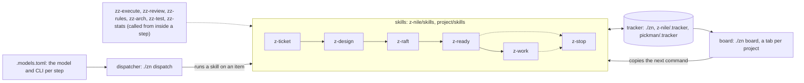
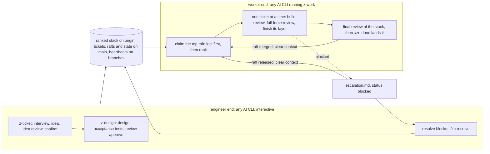

# z-nile

z-nile is the tooling that tracks, designs, gates and delivers the work of every project in this repository. A game is a project: pickman is one, in `pickman/`. The arcade adds five more (c0183): the shared library `arcade`, the start place `portal`, and the games `snake`, `invaders` and `asteroids`, each in its own folder. z-nile belongs to no game.

## Intent
z-nile exists so that people spend their time on ideas and designs, and agents carry everything after that to merge. This section is the intent, set by the user (2026-11-07, c0264); what of it is built is labelled sub-section by sub-section in How it should work.
- **People work at the idea and the design.** A person brings an idea. z-ticket challenges it, keeps the person's words and every question and answer, writes the idea out clean, has it checked against what they said and confirms it with them. z-design turns the confirmed idea into a design with acceptance tests as code, reviewed back and forth, and a person approves it. Apart from resolving a block, and giving a rank when a person wants one, those are the only two stages that ask a person for anything.
- **Workers carry it to merge.** A worker is any AI CLI running `z-work`. It takes a raft and stays with it until it merges, one ticket at a time, then clears its context and takes the next raft.
- **The result stays true to the ask.** Reviews are back and forth, except for the last one, which just verifies that the diff matches the original ask. Before each ticket's layer is complete, that final full-force review compares the original ask, the design and the implementation, without the compromises made on the way, and sends the work back when it went off course.
- **It stays cheap.** Expensive models do every final review; cheaper, faster ones do the work on the way there; the cheapest do the waiting. An expensive model never orchestrates or waits.
- **Every decision has a name.** A ticket says whose idea it was, who approved its design, who unblocked it and which worker delivered it.

## How it should work
Status labels, on every sub-section below and every roadmap row (*captured* is this section's word for an issue that exists as a draft): **exists** (built and on `main`), **designed** (its issue's Design is ready, not built), **captured** (an issue exists as a draft with no design yet). Nothing below is described as built unless it is labelled *exists*. A feature's PR changes its own roadmap row and every label that names it. Older notes in this file written "(cNNNN, planned)" predate these labels and mean not built.

### Two ends, one stack
- **The engineer end.** You sit in any AI CLI (`claude` and `agent` today; another CLI once its skill support is checked, c0115) in the main checkout and run the front of the pipeline: `z-ticket` to capture, `z-design` to sharpen an idea into a prepared issue, the design review. Everything you produce is tracker state landed on `main`: by pull request, or, for a capture or a claim, pushed straight to it (`./zn land`, `./zn status`). *exists*
- **The worker end.** Any AI CLI runs the back of the pipeline: you start one by hand and run `z-work` in it, or a wrapper launches one headless (`./zn work`), on the same host or another. *captured* (c0253), on top of c0117's dispatcher (`./zn dispatch`, its chain, `.models.toml`, quota fallback, spend), which *exists* (c0117).
- **The only shared thing is `origin/main` and GitHub.** No daemon, no queue server. A worker on another machine needs a clone, its CLIs and a bot credential; the engineer sees it work on the board. *captured* (c0254)

### The idea stage
z-ticket writes an idea as checkable outcomes and challenges it once before anything is designed. Today `./zn idea <id>` does this: the `idea` role writes the Problem, Solution and Non-goals, the `idea-challenge` role writes `idea-review-001.md`, the author answers each finding in `idea-refute-001.md`, and what stays disputed goes under `## Open to the human`. `./zn status <id> preparing` is refused, for a ticket captured since (one with an `idea:` key), until the review is on `origin/main` and every open point is ruled by a person. *exists*
- The ticket also keeps the person's ask verbatim, every message of it, dated, and every question z-ticket asked with its answer, in order. *designed* (c0260)
- From all of that z-ticket writes a clean, fully formed idea, and a clean adversarial reviewer on an expensive model checks that it says what the person said: nothing dropped, added or bent. *designed* (c0260)
- The person confirms the idea as it then stands, and the confirmation is recorded on the ticket. Only a confirmed idea goes to z-design, which works as it does today: a design, acceptance tests as code, a review, a person's approval. *designed* (c0260)
- c0247, which has z-ticket confirm intent before it creates a ticket, comes first, and c0260 builds on it.

### The worker
Today a person can run `z-work` in the CLI they opened: that session takes the next prepared raft, or the one named (`./zn work <R>`), says what it took, and carries it layer by layer to `./zn done`. With a raft named it then stops; with none named it goes on to the next raft ready would accept, in the same context, and stops when none is claimable or after two rafts in a row are released as blocked. *exists*

A worker is an AI CLI running `z-work`: `kimi`, `agy`, `claude`, `grok`, `agent` or `deepseek`. *captured* (c0253); the CLIs beyond `claude`, `grok` and `agent`, `deepseek` through `opencode`: *captured* (c0175).
- It claims the first raft in the order and stays with it all the way to merge, delivering it as a PR stack, one ticket at a time.
- It keeps one context for the whole raft, so what it learned on one ticket carries to the next.
- A worker clears its context and picks up the next raft whenever a raft ends: when the raft is merged, or when it is blocked and the worker lets it go. No context carries from one raft to the next.
- It lets go of a raft only when the raft is blocked.
- When no raft is claimable the worker waits, polling `origin/main` from a plain `./zn` loop with no model running, and it may draft the design of a confirmed idea, which stops at a person's `./zn approve`.
- The worker itself runs on a cheap model: it never orchestrates on an expensive one, and its waiting (for a gate, CI or a review it handed to an expensive model) runs on the cheapest model.
- A CLI that cannot read skills gets the same instructions from a `./zn` command.

### Order
Tickets have no order today. They should: every issue and raft gets a `rank:` (integer, lower first; not the `rank` of `.models.toml`, where a higher one wins). *captured* (c0249)
- An unset `rank:` is the lowest rank, and equal or unset ranks fall back to the ticket number, so the order is always stable.
- Lost work comes first: anything in progress whose heartbeat is stale (`./zn lost` lists it) comes before anything not yet started, whatever its rank, even when a person started it without changing its rank. *exists* (c0265)
- The next item is the first in that order whose `depends_on` are all done, which is not blocked, and whose status is claimable. `depends_on` is a hard constraint; `rank` only orders what is free, so the order works around a blocked item without changing any rank.
- z-ticket and z-design leave the rank unset, which appends; only a person sets one, with `./zn rank <id> top|after <id>|unset`. z-raft asks for a raft's rank when it makes the raft, and unset is a valid answer: with no one to answer, the rank stays unset. A rank given to a raft is the raft's own; an unset one takes its members' best. The board shows the stack in order.
- The board shows lost, parked and stale claims, lost first. *designed* (c0276)
- The z-nile app in Omarchy shows the same order, marks lost items, and reorders by drag and drop through `./zn rank`. *captured* (c0257)

### Claiming across hosts
A worker claims an item by landing the status change on `origin/main`, as `status <id> preparing` and z-ready already do. The push is the lock: a lost race means taking the next item. Each step runs in its own worktree under `.worktree/` on the worker's host, and a worker pushes its layer branch after every commit, so a taker on any host recovers all committed work. The worker's identity (host, CLI, model) goes on its spend rows. *captured* (c0254) (the claim itself *exists*)
- A worker that holds an item beats a heartbeat on it every 5 minutes, as a commit on a heartbeat branch, not on `main`; the branch is deleted when the heartbeat drops or the task completes. An item in progress whose heartbeat is stale is lost. *exists* (c0265)
- Agents keep their claims alive without remembering to beat: the claim paths, every `./zn` command in a worktree, long commands and the dispatcher beat. *designed* (c0275)
- A lost claim is taken over by the next worker as a normal claim, which resumes it and is recorded, and its old owner is refused and told: the takeover deletes the old heartbeat branch and creates a new one, so a worker that comes back learns it lost the claim. *designed* (c0274)
- A takeover discards the old worker's worktree, and a numbered copy recovers its work: the old worker's work is kept, and a numbered copy of it continues the work. *designed* (c0277)

### Autonomous delivery
Unless something blocks, once a person has approved its design, an item is rafted, executed, code-reviewed, full-force reviewed, tested and landed with no human in the loop. Rigor does not drop: tests first, sequestered `check.sh`, the full gate once at the merge, and a merge only when the stack is green and regression-free. This replaces c0117's "stops at a merge" gate: the stack lands through `./zn done`, with the dispatcher's credential, after its own checks. *captured* (c0252)

### Models per command and activity
`.models.toml` names a real model for each stage in its `[roles.*]` table: `idea`, `idea-challenge`, `design`, `design-challenge`, `raft`, `implementation`, `code-review` and `final-review`, each with its CLI, rank, token cap and effort and a fallback list, and spend records the model. No level has a name. *exists*
- Every review runs on an expensive role: `idea-challenge`, `design-challenge`, `code-review`, `final-review`, and `raft` for a raft's review. `idea-challenge` and `code-review` name the role that wrote the text as their `author`, which drops that model; `design-challenge` and a raft's review run on the same model as their author. The cheaper `implementation` role builds and the `idea` role drafts. *exists*
- A command refuses a design review or a final review recorded off its role's kind of model. *designed* (c0306)
- The cheapest do the waiting: the dispatcher no longer stops at a gate just to wait, and polls it on the cheapest model of the CLI, so no expensive model waits on a gate. *captured* (c0305)
- Metrics show the cost per model, from the real model on each spend row. *captured* (c0307)

### Reviews by different models
- A reviewer should run on a different model family than the author, and successive rounds rotate. `.models.toml` names a review pool; the dispatcher takes the first member whose family differs from the author's and the previous reviewer's. *captured* (c0251); today `idea-challenge` and `code-review` name an `author`, which drops that model from their lists. *exists*
- Same-family review (Opus reviewing Opus) is fine, but it is the fallback and never the only choice: it runs only when no different-family CLI can (out of tokens or quota, CLI missing). It never blocks the chain.
- Every review records its model and whether it was a fallback. The board flags fallback reviews so you can ask for a cross-model re-review when tokens return. Every finding is still harvested into a skill's lessons.

### The full-force review
Once per raft, on the finished stack, a final review checks that each ticket's design covers its idea and that the implementation delivers the design. `./zn trace <R-id>` prints a table with one row per claim of the Problem, Solution and acceptance criteria; the reviewer on the `final-review` role cites the design section, the test and the code for each, `./zn trace <R-id> --check` verifies it, `final-review-NNN.md` ends in a verdict, `approve` or `changes`, and `./zn done` refuses a stack without it. *exists*
- It runs in a fresh context with a limited view: the original ask (the verbatim ask, the interview and the confirmed idea), the design and the implementation as given. It sees no design reviews, refutes, harvests, PR comments or worker notes, so it judges the result on its merits and not through the compromises on the way. *designed* (c0262)
- It runs once per ticket, before the next layer starts, as part of that layer's completion. *designed* (c0262)
- Its verdict says plainly whether the work stayed on course, naming each gap against the ask or the design. *designed* (c0262)
- Off course means a redo: back to z-design when the design missed the idea, a rebuilt layer when the implementation missed the design, and then the review again. A second off-course verdict blocks the ticket. *designed* (c0262)

### Escalation to the human
A worker never guesses past a wall; it escalates formally. *designed* (c0250)
- **State.** The item goes to status `blocked` on `origin/main`, so every host and the board see it, with a `blocked:` reason from a closed list:

  | reason | meaning |
  |---|---|
  | `review-exhausted` | N review rounds, findings still open |
  | `design-gap` | the work needs a tool, library, dependency or scope the design did not cover |
  | `needs-decision` | an ambiguity only the human can settle |
  | `red-gate` | N fix attempts and the gate is still red |
  | `quota` | every CLI failed on quota |
  | `tripwire` | a guard fired (foreign refs, unvetted push to `main`) |

- **The note.** `escalation.md` in the item's folder, landed with the state: reason, what was tried, the open findings or error verbatim, the options with a recommendation, and the exact resume commands. It is in git, not `.cache`, so it works across hosts and replaces c0117's local `questions.md`.
- **The worker moves on.** A block on any ticket of a raft marks the raft blocked. The green layers below the blocked one land now, with one full gate on the top green one. The worker parks the branch and PR, releases its claim, clears its context and takes the next unblocked raft that does not depend on the blocked one.
- **You resolve.** The board lists blocked items first with the reason and the question. `./zn resolve <id> <decision>`, where the decision is `amend-design` (back to z-design with the note as input), `approve` (for example accept the new dependency, recorded in the design), `split` (carve out an issue), `retry` (more rounds or attempts) or `abort` (z-stop). The decision is committed to the item, with who made it, and the raft resumes at the blocked layer.
- Nothing else stops a worker.

### Provenance
Every ticket says who did what to it.
- The record is kept on the ticket and appended by the record's command. *exists* (c0263)
- The record holds who confirmed the idea and who set the rank as well: c0260 writes the first row and c0249 the second, through the record's small API. *exists* (c0263)
- `./zn who <id>` prints a ticket's history, oldest first: whose idea it was (the author of the ticket's capture commit), each status change, the merge, and the worker of each delivered layer, read from the ticket's spend rows; what git already knows is read from git and never stored. *designed* (c0280)
- The record gets a row, with its actor, when a ticket is unblocked, rafted or delivered. *designed* (c0282)
- A person approves a design with `./zn approve <id>`, which records the person and a hash of the design sections, the acceptance specs and `check.sh` in the issue's `approval.md`; `ready` and `done` refuse a design that changed since. *exists*
- `./zn approve` is also refused in any agent session, terminal or not, and records an `approved` row in the record (the person and the first 12 hex of the design hash, no words). *designed* (c0283)
- The board shows each ticket's provenance, the same entries `./zn who` prints. *designed* (c0284)

### Trust
*exists* (c0117).

Workers run with a bot credential that can push branches and open PRs but cannot merge or bypass `main`'s protection; only the dispatcher merges. The guards (git/gh wrapper, publish broker, tripwire) catch honest mistakes and casual misbehaviour; none is a boundary against a determined agent (c0117).

### Roadmap
| piece | issue | state |
|---|---|---|
| `.models.toml`, dispatcher, chain, quota fallback, bot credential | c0117 | exists |
| board, a tab per project | c0118 | exists |
| remote runtimes (`claude-cloud`, `grok-bot`, `cursor-app`) | c0142 | captured |
| `agy`, `kimi` and `deepseek` as CLIs | c0175 | captured |
| a raft delivered as a stacked PR set, one layer per issue, each finished before the next | c0248 | designed |
| `rank`, `./zn rank`, `./zn next`, lost first | c0249 | captured |
| `blocked`, `escalation.md`, `./zn resolve` | c0250 | designed |
| cross-model review pool, same-family fallback | c0251 | captured |
| the dispatcher lands a green stack | c0252 | captured |
| `./zn work` pull loop (the interactive session worker exists; the headless loop does not) | c0253 | captured |
| workers on several hosts, worker identity in spend | c0254 | captured |
| the z-nile app in Omarchy: order, lost items, drag and drop | c0257 | captured |
| `./zn land` usage and a cheap retry | c0258 | designed |
| the capture interview, idea review and confirmation | c0260 | designed |
| the full-force review: limited view, verdict, redo | c0262 | designed |
| provenance: the record and its command | c0263 | exists |
| the heartbeat branch, `./zn beat`, lost work | c0265 | exists |
| take over a lost claim, the old owner told | c0274 | designed |
| automatic heartbeats | c0275 | designed |
| the board shows lost work | c0276 | designed |
| discard and recover a worktree: the numbered copy | c0277 | designed |
| `./zn who`, the history from git | c0280 | designed |
| provenance rows: unblocked, rafted, delivered | c0282 | designed |
| `./zn approve` refused in an agent session, the approved row | c0283 | designed |
| the board shows provenance | c0284 | designed |
| the dispatcher waits on a cheap model | c0305 | captured |
| commands refuse a review off the review models | c0306 | designed |
| metrics show cost per model | c0307 | captured |

c0248 to c0254 stay one raft, delivered as one stack in that order, and it starts only when every outside dependency of its members is done: c0256, c0257, c0260, c0263, c0283, c0305, c0306 and the heartbeat tickets c0265, c0274, c0275 and c0277, and c0325. The other worker tickets (c0262, c0280, c0282, c0284, c0307, c0276) are designed one at a time with the user and then rafted; c0264 is this README chore. c0258 (a capture lands with `./zn land`, which should print usage on `--help` and retry cheaply when `main` moves) is separate.

### Stacked delivery
A raft is delivered as a stack: `./zn start` opens one layer per ticket (a branch and a draft PR on the layer below), in the raft's Order, `./zn finish` makes a layer one commit, `./zn restack` brings the stack onto a moved `main`, and `./zn done` lands it with one bind after the final review and the affected gate. A one-issue raft is a stack of one. *exists*
- Each ticket is worked to completion before the next is picked up, by the same worker, so its context carries over: a layer is complete when it is built, reviewed and green on top of the layer below (its full-force review is c0262's), and the stack lands with one full gate on its top. A blocked layer stops the layers above it, not the ones below. *designed* (c0248)

## The five parts
- **The tracker.** `./zn` at the repository root runs the engine in `z-nile/engine/`. Each project keeps its issues and rafts in its own root, `<project>/.tracker/` (z-nile's in `z-nile/.tracker/`), listed in `z-nile/projects.toml`. One counter, `z-nile/next`, numbers every project. The rules are in the zz-rules skill.
- **The skills.** z-nile's skills live in `z-nile/skills/`, and a project's own in `<project>/skills/`. `.claude/skills/<name>` is a committed relative link to each, written by `./zn skills` and checked by `./zn skills --check` in the gate. The `z-` skills are the pipeline, in the order above; the `zz-` skills are called only from inside a step. Both prefixes are z-nile's: a project's skills are named `<project>-…`.
- **The dispatcher.** `./zn dispatch <id>` runs the chain on an item from its tracker state (ticket, design, raft, ready, run), headless and unattended, up to the run's pull request: script steps (`ready`, `raft-plan`, `spend`, …) it runs itself, model steps on the CLIs `.models.toml` orders, moving down the order only when a CLI fails on quota. It stops at a merge gate, at a step's `questions.md` and at a failure, and records each step's tokens and model on its spend row. A running step appends one short line per action (the tool and its target, or the first words of a message) to `.cache/dispatch/<id>/trail.log`, and `./zn dispatch status <id>` prints the last of those lines and the running token count before the step's JSON. Agents run with `z-nile/bin/git` and `gh` first on their PATH. Agents run as your own OS user, so its guards (the wrapper, the publish broker, the tripwire, the merge gates) detect honest mistakes and casual misbehaviour; none of them is a security boundary against a determined agent. A run accepts `main` as it is when it starts, and during the run a rewritten `main` or a commit that is not tracker state and not a pull request's merge stops it. The rules are in the zz-rules skill, Dispatch.
- **`.models.toml`.** It says, per model step and CLI (`claude`, `grok`, `agent`), the model, its rank, runtime and `max_tokens`, and the CLI priority order, stacking from the repository root down to the work, as `.gitignore` does.
- **Provenance.** `<ID>/provenance.md` records who decided what that git cannot tell (append-only rows, `./zn provenance record`, checked by `./zn audit`; zz-rules skill, Provenance); the engine's merges of `origin/main` unite two writers of it, and zz-rules, Provenance, says how to merge when `./zn sync` stops, and names the actor options (`--actor`, `ZN_ACTOR`) and the session variables.
- **The board.** `./zn board` writes the whole tracker as one page (`.cache/board.html`): a tab per project, its issues as cards in the pipeline's columns with each raft a band behind its members, the review charts, and the next command for each row (c0118). `./zn board --serve` (c0121, planned) serves the same page live.
- **The omarchy board app.** `z-nile-omarchy/znile.board/` (c0257) is an omarchy-shell plugin that shows the same board model in a bar icon and a tiled window on Linux. It reads the page's embedded JSON through `./zn board`, so it is a second view of the board, not a second source; it is part of the z-nile project and no registered project of its own.

## Skills
| skill | step | what it does |
|---|---|---|
| `z-ticket` | 1 | captures a feature, defect or chore as a backlog issue, in a `capture-<slug>` worktree, landed with `./zn land` |
| `z-design` | 2 | designs one issue to `design: ready` and `prepared`: Design, `size:`, `check.sh`, acceptance specs, experiments, the adversarial design review. It makes no raft |
| `z-raft` | 3 | groups prepared issues into rafts (`./zn raft-plan`, or as asked), writes each raft's Theme, Order and interfaces, and runs a short coherence review for a raft of several issues |
| `z-ready` | 4 | from the main checkout: claims a prepared raft, moves it to `active/`, writes its `prompt.md` |
| `z-work` | 5 | the worker a person starts (`./zn work`, or `./zn work R0010`): one raft, one next action at a time, until it lands or is released |
| `z-run` | 5 | `/z-run R0010` is z-work with that raft named. Under `./zn dispatch` it is the headless run step |
| `z-stop` | any | gives a readied or started raft back; its branch and PR stay |
| `zz-execute` | from z-work | the execution protocol: one branch, one PR, experiments, tests first, review, done, merge |
| `zz-review` | from z-design, z-raft and zz-execute | the clean adversarial reviewer: design, raft, stream and code modes |
| `zz-rules` | every step | the tracker's rules: ids, roots, lifecycle, worktrees, landing, spend |
| `zz-arch` | design and build of the tooling | the tooling's code structure |
| `zz-test` | every step | the gate, the spec runner, `check.sh`, sequestration and the guards |
| `zz-stats` | on demand | cost per issue and the rework rate |
| `pickman-arch`, `pickman-test` | pickman's design and build | pickman's code structure, and its game spec tiers |
| `arcade-arch`, `arcade-test`, `portal-arch`, `portal-test`, `snake-arch`, `snake-test`, `invaders-arch`, `invaders-test`, `asteroids-arch`, `asteroids-test` | the arcade's design and build (c0184) | each project's code structure (pickman's rules, with the changes the skill states) and its spec tiers |

## A project's home
A project with code has a home, `<name>/`, which also holds its `.tracker/` root. `pickman/` and the arcade's five (`arcade/`, `portal/`, `snake/`, `invaders/` and `asteroids/`, c0184) have the same home; the gate checks it for every project of `z-nile/projects.toml` except z-nile, whose home holds the tooling:
- `check.sh`: the project's gate, `exec bash "$(dirname "$0")/../z-nile/check.sh" --project <name> "$@"`.
- `.luaurc`, with the aliases `logic`, `shared`, `tests` and `znile` pointed at the home's own folders (`znile` at `../z-nile`), `arcade` at the library's `src/shared` (`../arcade/src/shared`, the same line in every home, the library's included), and `stylua.toml` and `selene.toml`, the root's.
- `default.project.json`, and any other `*.project.json`: the places the home builds. Every `$path` is a folder of the home, but for the library's two (`../arcade/src/shared` and `../arcade/src/server`), which the default place maps as `ReplicatedStorage.Arcade` and `ServerStorage.Arcade` in every home (c0185). A `$path` is a string or `{"optional": "<path>"}`; any other value is reported, because the reader of the project files cannot follow it. The rule also asks Rojo itself what each project file builds, reports a file Rojo reads from outside the home and the library's two folders, a library file Rojo puts anywhere but at its node, and a project file Rojo loads from a mapped folder.
- `src/shared/Logic/` and `src/server/`, and `src/client/` for a place with a client.
- `tests/run.luau` (the shared runner, run from the home), `tests/lib/t.luau` and `renamed.luau` (its re-exports), and `tests/meta/architecture.spec.luau`, `fence.spec.luau` and `home.spec.luau`: the structural rules of pickman-arch, the repository-fence spec and this home rule, each run from the home. `tests/lib/place.luau` (the shared place harness, re-exported) and `tests/place/library.spec.luau` (the shared place spec, called with it) are the home's place tier.
- `skills/<name>-arch/SKILL.md` and `skills/<name>-test/SKILL.md`, linked into `.claude/skills/` by `./zn skills`.
- In its root, `architecture.md`, with one `deps` block.

A new project with code needs its registry entry, its root and `deploy.yml` entry (zz-rules skill, Projects) and this home. Make the home by copying a sibling's and renaming it; the gate's home rule names whatever is missing.

## Design checklists
z-design reads the checklist for the issue's type before it writes the Design:
- `z-nile/skills/z-design/checklists/feature.md`
- `z-nile/skills/z-design/checklists/defect.md`
- `z-nile/skills/z-design/checklists/chore.md`

## The flow
One type per raft: feature (`f`), defect (`d`) or chore (`c`). Every project root holds all three, z-nile's included (c0266): a wrong spec is a chore, and a z-nile command, gate or guard that does the wrong thing is a defect (z-ticket). A lone issue still gets a raft.
1. **z-ticket**, in `capture-<slug>`: the issue lands on `main` with `design: draft` and status `new`. No PR.
2. **z-design**, in `prep-<slug>`: `status <id> preparing` claims one issue; its design, checks and specs are written and reviewed; then `design: ready`, status `prepared`, and its design PR merges. It has no raft yet.
3. **z-raft**, in `raft-<slug>`: `./zn raft-plan` groups the prepared issues (or the arguments say which), each raft is claimed (its status only) and its members' `raft:` lines are written; the raft's own design and, for several issues, a coherence review; then the rafting PR merges.
4. **z-ready**, from the main checkout: the raft and its issues move to `active/`, and the prompt is written (ignored by git).
5. **z-work**: `./zn work` (or `./zn work R0010`) in a session a person opened takes the next prepared raft, or that one, and follows zz-execute one layer at a time. `start` opens a draft PR; experiments, tests, the change, a clean code review; `./zn done` promotes the specs, moves the items to `done/` and marks the PR ready; the PR merges when the gate and CI are green. `/z-run R0010` is z-work with that raft named. The session ends when the raft lands or is released.
6. **z-stop**, from the main checkout: an `active` raft goes back to `prepared` and its prompt is deleted. The PR stays open.

`design:` is separate from status: z-design changes an issue's and z-raft a raft's, `draft` → `reviewed` → `ready`.

## Where the work lives
The main checkout stays on `main`; every edit is made under `.worktree/` (zz-rules skill, Worktrees).

| work | worktree |
|---|---|
| capture | `capture-<slug>` |
| prep | `prep-<slug>` |
| rafting | `raft-<slug>` |
| execution | `R0010`, branch `R0010-<slug>`, one PR |
| a skill, doc or config edit | `<area>-<slug>` |
