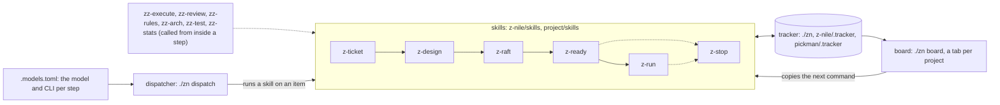
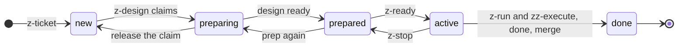

# z-nile

z-nile is the tooling that tracks, designs, gates and delivers the work of every project in this repository. A game is a project: pickman is one, in `pickman/`. z-nile belongs to no game.

## The five parts
- **The tracker.** `./zn` at the repository root runs the engine in `z-nile/engine/`. Each project keeps its issues and rafts in its own root, `<project>/.tracker/` (z-nile's in `z-nile/.tracker/`), listed in `z-nile/projects.toml`. One counter, `z-nile/next`, numbers every project. The rules are in the zz-rules skill.
- **The skills.** z-nile's skills live in `z-nile/skills/`, and a project's own in `<project>/skills/`. `.claude/skills/<name>` is a committed relative link to each, written by `./zn skills` and checked by `./zn skills --check` in the gate. The `z-` skills are the pipeline, in the order above; the `zz-` skills are called only from inside a step. Both prefixes are z-nile's: a project's skills are named `<project>-…`.
- **The dispatcher.** `./zn dispatch <id>` runs the chain on an item from its tracker state (ticket, design, raft, ready, run), headless and unattended, up to the run's pull request: script steps (`ready`, `raft-plan`, `spend`, …) it runs itself, model steps on the CLIs `.models.toml` orders, moving down the order only when a CLI fails on quota. It stops at a merge gate, at a step's `questions.md` and at a failure, and records each step's tokens and model on its spend row. Agents run with `z-nile/bin/git` and `gh` first on their PATH. Agents run as your own OS user, so its guards (the wrapper, the publish broker, the tripwire, the watermark, the merge gates) detect honest mistakes and casual misbehaviour; none of them is a security boundary against a determined agent. The watermark file is shared by every dispatcher of the repository and only moves forward. The rules are in the zz-rules skill, Dispatch.
- **`.models.toml`.** It says, per model step and CLI (`claude`, `grok`, `agent`), the model, its rank, runtime and `max_tokens`, and the CLI priority order, stacking from the repository root down to the work, as `.gitignore` does.
- **The board.** `./zn board` writes the whole tracker as one page (`.cache/board.html`): a tab per project, its issues as cards in the pipeline's columns with each raft a band behind its members, the review charts, and the next command for each row (c0118). `./zn board --serve` (c0121, planned) serves the same page live.

## Skills
| skill | step | what it does |
|---|---|---|
| `z-ticket` | 1 | captures a feature, defect or chore as a backlog issue, in a `capture-<slug>` worktree, landed with `./zn land` |
| `z-design` | 2 | designs one issue to `design: ready` and `prepared`: Design, `size:`, `check.sh`, acceptance specs, experiments, the adversarial design review. It makes no raft |
| `z-raft` | 3 | groups prepared issues into rafts (`./zn raft-plan`, or as asked), writes each raft's Theme, Order and interfaces, and runs a short coherence review for a raft of several issues |
| `z-ready` | 4 | from the main checkout: claims a prepared raft, moves it to `active/`, writes its `prompt.md` |
| `z-run` | 5 | launches a readied raft from the main checkout (`/z-run R0010`): reads its prompt, enters its worktree, hands off to zz-execute |
| `z-stop` | any | gives a readied or started raft back; its branch and PR stay |
| `zz-execute` | from z-run | the execution protocol: one branch, one PR, experiments, tests first, review, done, merge |
| `zz-review` | from z-design, z-raft and zz-execute | the clean adversarial reviewer: design, raft, stream and code modes |
| `zz-rules` | every step | the tracker's rules: ids, roots, lifecycle, worktrees, landing, spend |
| `zz-arch` | design and build of the tooling | the tooling's code structure |
| `zz-test` | every step | the gate, the spec runner, `check.sh`, sequestration and the guards |
| `zz-stats` | on demand | cost per issue and the rework rate |
| `pickman-arch`, `pickman-test` | pickman's design and build | pickman's code structure, and its game spec tiers |

## Design checklists
z-design reads the checklist for the issue's type before it writes the Design:
- `z-nile/skills/z-design/checklists/feature.md`
- `z-nile/skills/z-design/checklists/defect.md`
- `z-nile/skills/z-design/checklists/chore.md`

## The flow
One type per raft: feature (`f`), defect (`d`) or chore (`c`). CI and test fixes are chores. A lone issue still gets a raft.
1. **z-ticket**, in `capture-<slug>`: the issue lands on `main` with `design: draft` and status `new`. No PR.
2. **z-design**, in `prep-<slug>`: `status <id> preparing` claims one issue; its design, checks and specs are written and reviewed; then `design: ready`, status `prepared`, and its design PR merges. It has no raft yet.
3. **z-raft**, in `raft-<slug>`: `./zn raft-plan` groups the prepared issues (or the arguments say which), each raft is claimed (its status only) and its members' `raft:` lines are written; the raft's own design and, for several issues, a coherence review; then the rafting PR merges.
4. **z-ready**, from the main checkout: the raft and its issues move to `active/`, and the prompt is written (ignored by git).
5. **z-run**: `/z-run R0010` in a session started in the main checkout reads the prompt, enters `.worktree/R0010` and hands off to zz-execute: `start` opens a draft PR; experiments, tests, the change, a clean code review; `done` promotes the specs, moves the items to `done/` and marks the PR ready; the PR merges when the gate and CI are green.
6. **z-stop**, from the main checkout: an `active` raft goes back to `prepared` and its prompt is deleted. The PR stays open.

`design:` is separate from status: z-design changes an issue's and z-raft a raft's, `draft` → `reviewed` → `ready`.

## Where the work lives
The main checkout stays on `main`; every edit is made under `.worktree/` (zz-rules skill, Worktrees).

| work | worktree |
|---|---|
| capture | `capture-<slug>` |
| prep | `prep-<slug>` |
| rafting | `raft-<slug>` |
| execution | `R0010`, branch `R0010-<slug>`, one PR |
| a skill, doc or config edit | `<area>-<slug>` |
